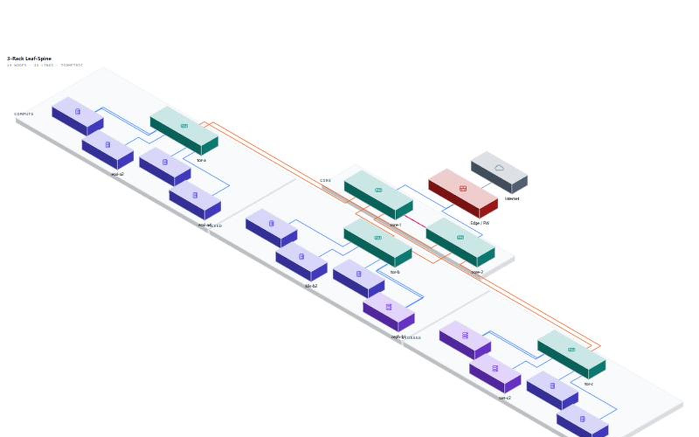
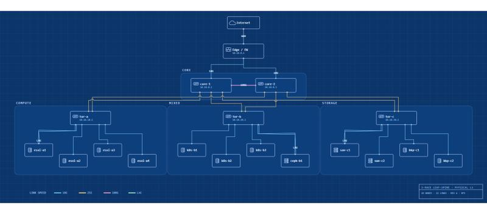
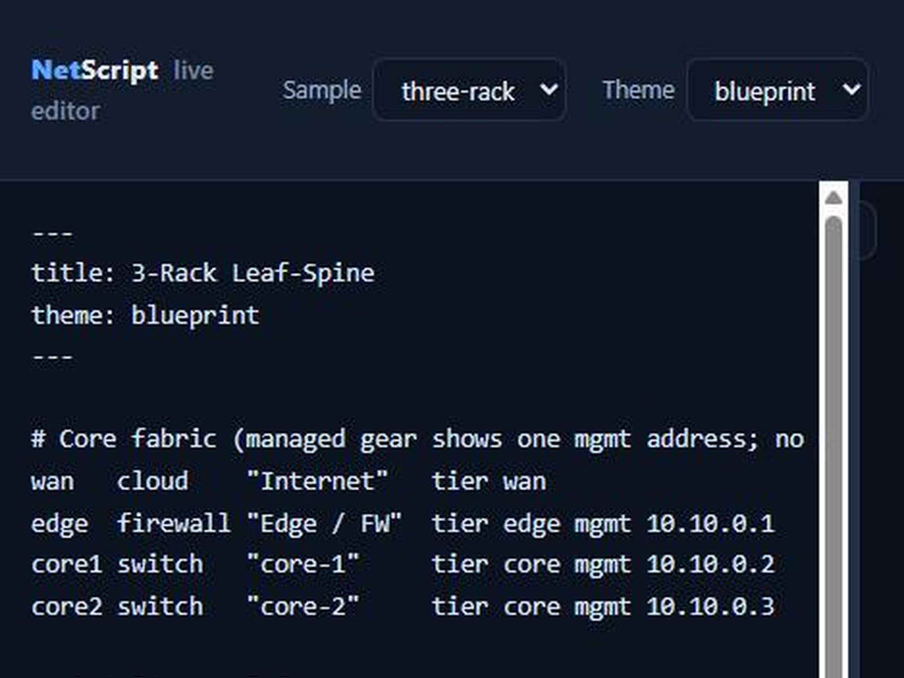

# NetScript

Diagram-as-code for network topologies — write a `.net` text file, get a clean, production-ready SVG.



Network diagrams go stale the moment you stop touching them, and drawing tools don't scale to real infrastructure. NetScript compiles a readable DSL directly to SVG, so your diagram lives next to the code that describes the topology and updates in seconds.

## What it does

- **`.net` DSL** — declare devices, racks, links, VLANs, bonds and L4 services in plain text
- **Two projections** — `flat` (default) for clarity, `iso` for depth; any diagram works in both
- **Themes** — `clean` (dark, minimal) and `blueprint` (grid paper, technical feel)
- **Traffic view** — layer L4 flows over the topology to show what talks to what and on which port
- **Live editor** — open `editor/netscript-editor.html` locally; no server, no telemetry, the `.net` source stays on your machine
- **MCP server** — `compile_net` and `render_net` tools let an LLM generate or update diagrams on your behalf
- **CLI** — pipe `.net` files to SVG in one command

## Quick start

```bash
node src/cli.ts --example three-rack --projection iso -o out.svg
```

Node 24 or later runs the TypeScript source directly. Open `out.svg` in any browser.

To use the live editor, open `editor/netscript-editor.html` in a browser (double-click works on Windows and macOS).

## Screenshots



*The same three-rack topology rendered in the blueprint theme.*



*The self-contained live editor — paste `.net` source, see SVG instantly.*

## CLI reference

```
node src/cli.ts <file.net> [options]
node src/cli.ts --example <name> [options]

Options:
  --projection flat|iso    rendering projection (default: flat)
  --theme clean|blueprint  colour theme (default: clean)
  --view topology|traffic  which layer to show (default: topology)
  -o <path>                output file (default: stdout)
```

Bundled examples: `three-rack`, `homelab`, `sql-traffic`.

## MCP server

```bash
node src/cli.ts mcp
```

Exposes `compile_net` (`.net` text to NetModel JSON) and `render_net` (NetModel to SVG). Works with any MCP-compatible client (Claude Desktop, Continue, etc.).

## Building

```bash
npm run build        # core library -> dist/
npm run build:mcp    # MCP server -> dist/
npm run build:editor # self-contained editor HTML
npm run typecheck    # tsc --noEmit, no output
```

Node 24+ runs the sources directly without a build step for development.

## License

[MIT](LICENSE)

## Feedback

Questions, ideas and bug reports are welcome in [Issues](https://github.com/kilrkrow/netscript/issues).

---

Built by kilrkrow · [Fox & Dove](https://foxanddoveconsulting.com) · more tools at [github.com/kilrkrow](https://github.com/kilrkrow)
